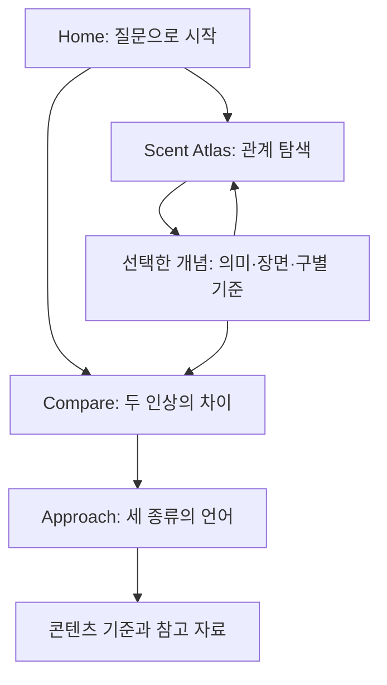

# 기록: 초기 12개 개념 프로토타입

현재 A 대안의 제출 기획은 [submission-atlas](../submission-atlas/PROJECT-PROPOSAL.md)를 참고하세요.

# The Language of Scent — Midterm proposal v1

추가 대화를 반영한 발전 방향은 [The Anatomy of Scent 제안](NEXT-DIRECTION.md)에 정리했습니다.
이 문서는 현재 구현된 향 지도·표현 비교 v1의 기획 기록입니다.

## 1. Concept / Premise

“파우더리한 우디 향”이라는 문장을 읽어도, 향을 떠올리지 못할 수 있다.
우리의 출발점은 제품 검색이 아니라 이 이해의 간극이다.

**향을 설명하는 추상적인 표현을 관계, 장면, 비교로 이해하는 인터랙티브 웹 경험.**

우리가 먼저 보여주는 것은 궁금한 느낌, 그 표현의 의미, 다른 표현과의 차이다.
단어를 선택하면 닮은 개념은 강조되고 다른 개념은 물러난다.
두 인상을 겹쳐 보면서, 다음 시향에서 무엇에 주목할지 발견한다.

## 2. Intended experience

| 항목 | 사용자에게 일어나는 변화 |
| --- | --- |
| Feel | 조용한 관찰실에 들어온 듯한 여유와 호기심 |
| Notice | 같은 단어처럼 보여도 계열·노트·표현은 다른 정보라는 사실 |
| Discover | 보송함과 매끈함, 비누의 기억과 깨끗함의 차이 |
| Understand | 하나의 노트가 여러 표현으로 설명되고, 같은 표현도 맥락에 따라 달라짐 |
| Do | 질문 선택 → 의미 읽기 → 관련 개념 탐색 → 두 인상 비교 |

Before: “Woody는 나무 향인 건 알겠는데, 어떤 나무 느낌이지?”
After: “Dry woody는 마른 나무의 결, Creamy woody는 둥글고 매끈한 질감에 주목해볼 수 있겠다.”

## 3. 정보 체계와 콘텐츠 범위

| 정보 종류 | 답하는 질문 | 현재 콘텐츠 | 표현 방식 |
| --- | --- | --- | --- |
| Family | 어느 방향인가? | Woody, Floral | 채운 원 · 큰 계열 이름 |
| Note | 무엇을 떠올리는가? | Rose, Cedarwood, Sandalwood | 빈 마름모 · 구체적 대상 |
| Descriptor | 어떻게 느껴지는가? | Powdery, Soapy, Musky, Clean, Dry, Creamy, Green | 빈 원 · 질감과 인상 |

이것은 모든 향 분류를 담은 향 휠이 아니다. 세 종류의 정보가 **서로 다른 역할을 하면서 연결되는 관계도**다.
노트가 원료의 포함을 보장하지 않으며, 표현이 단일 물질이나 향 계열을 뜻하지 않는다는 점도 설명한다.

각 개념에는 한 문장 요약, 의미, 떠올릴 장면, 구별하는 단서, 설명이 있는 관계, 다음 비교가 있다.
관계는 계열–노트, 계열–질감, 노트–표현, 겹치는 인상, 구별 기준으로 나누어 문장으로 보여준다.
연결선만으로 설명을 대체하지 않는다. 관계는 직접 연결된 것만 강조하며 자동으로 전이하지 않는다.

핵심 질문:

- Woody이면서 Dry한 것은 Creamy한 것과 어떻게 다른가?
- Soapy와 Powdery는 모두 깨끗하게 느껴질 수 있는데, 왜 다른 표현인가?
- Musky는 어떻게 깨끗함과 관능적인 온기를 모두 설명할 수 있는가?

## 4. References / Inspiration

사용자가 제공한 조사 출발점:

- [Scent Verdict](https://scentverdict.com/)와 [Scent Wheel](https://scentverdict.com/guides/scentwheel): 큰 계열을 보는 탐색 방식에서 출발하되, 여기서는 표현을 구별하는 질문을 입구로 삼는다.
- [Fragrantica Perfume Finder](https://www.fragrantica.com/perfume-finder/): 제품/노트 탐색과 구분되는 경험으로 설계한다. 제품을 찾기 전에 노트와 표현이 무엇인지 이해하게 한다.
- [Everfumed Scent Sign Quiz](https://everfumed.com/find-your-scent-sign-quiz/): 취향을 먼저 확정하기보다, 표현을 이해한 뒤 자신의 다음 질문을 선택하게 한다.
- [Fragrances of the World](https://www.fragrancesoftheworld.com/): 향 계열 체계를 추가 검토할 기준. 현재 화면은 해당 향 휠의 복제나 공인 분류도가 아니다.

시각적 사고의 출발점은 식물 관찰 노트, 등고선 지도, 종이 질감, 파우더와 나무 표면이다.
사진으로 특정 원료만 보여주기보다, 가루의 입자·나무 결·둥근 곡선을 서로 다른 감각의 비유로 사용한다.
외부 사이트 내용의 검증과 전문가 용례 검토는 다음 콘텐츠 리서치 단계에 남아 있다.

## 5. Mood / Vision board & Visual language

| 요소 | 결정 | 이유 |
| --- | --- | --- |
| 바탕 | 종이색 `#F6F5EF` | 눈부시지 않은 읽기 환경 |
| 본문 | 깊은 초록 `#263D32` | 식물과 관찰 노트를 연상하는 차분한 분위기 |
| 선택 | 연두 `#DEF19F` | 선택이 무엇인지 즉시 파악 |
| 비교 | 잎 초록 / 따뜻한 황토 | 두 인상을 색과 A/B 이름으로 함께 구분 |
| 제목 | Georgia serif / italic | 사전보다 감각적인 에디토리얼의 목소리 |
| UI | DM Sans + 시스템 한글 sans | 영어 개념과 한국어 설명의 위계 구분 |
| 형태 | 얇은 관계선, 서로 다른 기호 | 정보 유형과 연결을 읽는 단서 |
| 질감 | 보송한 입자, 가는 결, 둥근 곡선 | 정의를 단정하는 이미지가 아닌 감각의 보조 비유 |
| 여백 | 큰 제목 뒤에 조용한 탐색 영역 | 호기심 → 관찰 → 이해의 리듬 |

실제 구현의 비교 카드가 미니 무드보드 역할을 한다. 파우더 입자, 비누의 곡선,
마른 나무의 선, 크림의 둥근 표면, 머스크의 직물/온기 이미지를 CSS로 재구성했다.

## 6. Sitemap



한 페이지에서 진행되며 상세 설명은 지도 옆에서 바뀐다. 취향 저장, 제품 추천,
시간에 따른 향의 변화는 핵심 경험 검토 뒤의 확장이다. 현재 기능으로 가장하지 않는다.

## 7. User flow / 대표 시연

1. 첫 화면: “같은 Woody, 다른 질감” 질문을 선택한다.
2. 두 예시를 오각형에 겹쳐 보고 마른 결과 매끈한 질감의 차이를 읽는다.
3. 지도에서 Woody를 선택한다. Dry·Creamy는 표현, Cedarwood·Sandalwood는 노트임을 확인한다.
4. Cedarwood로 이동해 노트–표현 관계를 읽는다.
5. Soapy × Powdery로 바꾸어 청결함이 겹쳐도 초점이 다른 이유를 확인한다.
6. Clean musk × Warm musk로 바꿔 같은 용어의 두 맥락을 이해한다.

오각형의 축은 부드러움, 밝은 인상, 온기, 마른 질감, 피부의 연상이다.
축의 값은 **편집된 교육용 예시**이며 실제 강도·발향력·향의 유사도를 측정한 값이 아니다.
서로 다른 표현과 조합을 비교할 수 있지만, 계열과 노트를 같은 수준의 선택지로 섞지 않는다.

## 8. Wireframes / 중요한 상태

데스크톱:

```text
┌──────────────────────────────────────────────────────────┐
│ 이름                         Explore / Compare / Approach │
├──────────────────────────────────────────────────────────┤
│ 큰 질문과 감각적인 제목                    짧은 소개       │
│ 질문 1                   질문 2                 질문 3   │
├───────────────────────────────────┬──────────────────────┤
│ 서로 다른 기호를 가진 개념들       │ 선택한 정보 유형      │
│                                   │ 이름 / 의미          │
│ 관련 개념 강조 + 관계선            │ 떠올릴 장면          │
│ 다른 개념은 물러남                 │ 구별하는 단서        │
│                                   │ 관계 문장 / 비교 CTA │
├───────────────────────────────────┴──────────────────────┤
│ 질문 기반 비교 프리셋                                    │
│ 인상 A             오각형 + 텍스트 대안            인상 B │
│                 이 차이에 주목하세요                     │
├──────────────────────────────────────────────────────────┤
│ Family                  Note                  Descriptor │
└──────────────────────────────────────────────────────────┘
```

선택 전: 전체 관계 보기 + 시작 질문.
선택 후: 해당 단어가 연두색으로 선택되고 직접 연결된 개념에 테두리가 생긴다.
비교 후: 두 도형, 두 장면, 핵심 차이 문장이 함께 바뀐다.
같은 대상을 선택하면 완전히 겹친다는 점과 다른 단어를 선택하라는 안내를 보여준다.

## 9. Responsive intentions / 접근성

- 760px 이하에서는 공간 지도 대신 같은 기호를 유지하는 3열 개념 탐색으로 전환한다.
- 관계선이 없어져도 선택 상태와 실제 관계 설명은 유지한다. 상세 설명은 아래로 이동한다.
- 비교는 A/B 카드를 먼저 나란히 보여주고 오각형을 그 아래에 넓게 배치한다.
- 질문 버튼은 세로로 쌓고, 정보 체계는 한 열로 재구성한다.
- hover만으로 정보를 숨기지 않는다. 버튼과 select로 클릭·터치·키보드 모두 사용할 수 있다.
- 선택은 색뿐 아니라 `aria-pressed`, 테두리, 상세 제목으로 표현한다.
- 차트와 같은 내용을 텍스트 표로 제공한다. 기호는 항상 유형 이름과 함께 표시한다.
- `prefers-reduced-motion`에서 전환과 스크롤 움직임을 줄인다.
- 참고 자료는 Escape로 닫을 수 있는 native dialog로 제공하고 초점을 호출 버튼으로 돌린다.

## 10. 발표 구성 — 약 5분

1. **문제 (40초)**: “Powdery”만 읽고 어떤 향인지 상상할 수 있는가?
2. **콘셉트 (40초)**: 제품을 찾기 전에 향의 언어를 이해한다.
3. **정보 체계 (40초)**: Woody / Sandalwood / Creamy는 다른 질문에 답한다.
4. **대표 경험 시연 (90초)**: 지도 → 관계 → Dry woody / Creamy woody 비교.
5. **시각 언어와 반응형 (40초)**: 종이·결·입자, 모바일에서 달라지는 관계.
6. **피드백 질문 (30초)**: 설명을 읽은 뒤 무엇에 주목할지 더 명확해졌는가?

피드백에서 확인할 것: 세 정보 유형을 구분하는지, 오각형을 실측 데이터로 오해하는지,
첫 질문에서 차이의 단서를 얻기까지 몇 번 클릭하는지, 모바일에서 관련 개념을 찾을 수 있는지.
